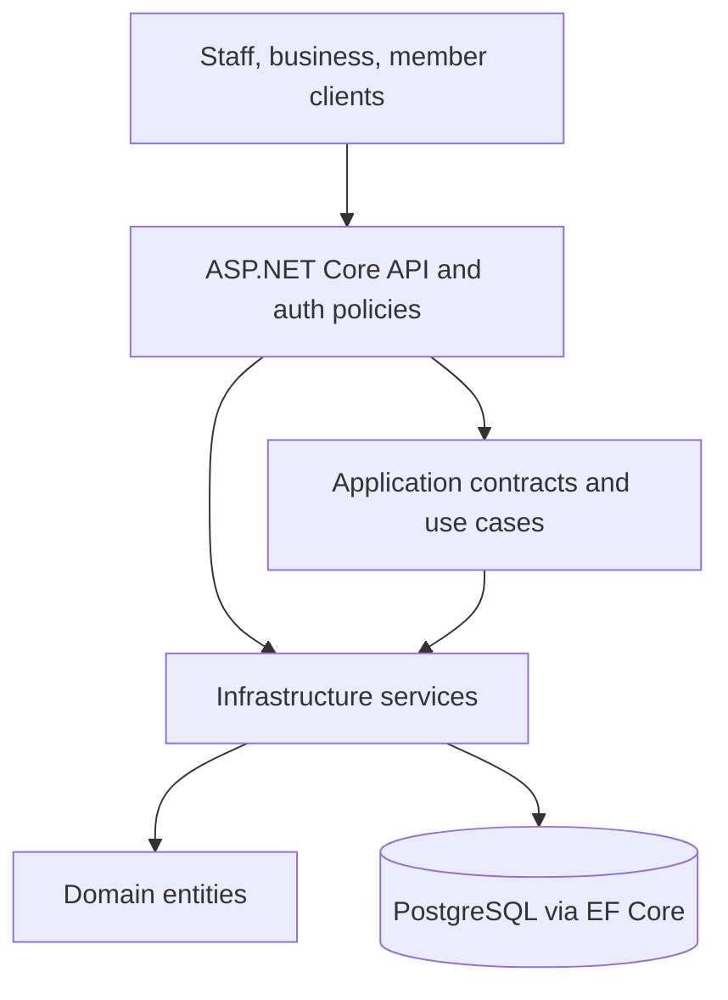
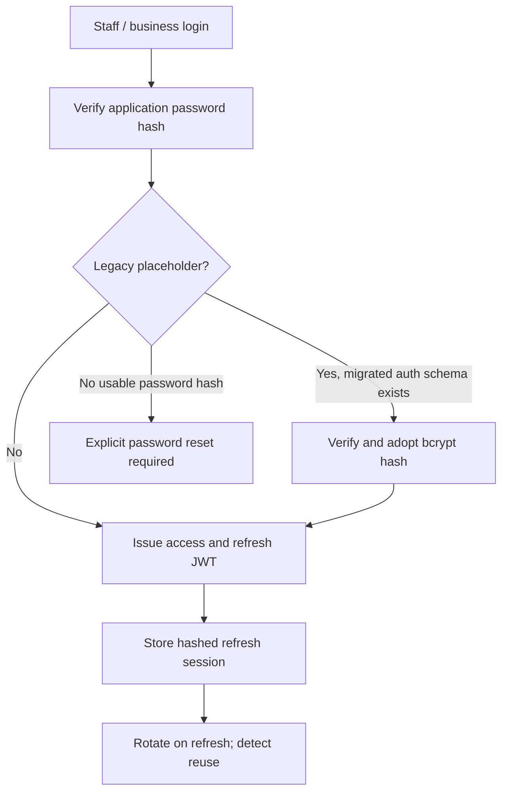

# Backend Loyalty — architecture and critical flows

This is an implementation-oriented view of the default branch, not a
production-readiness certification.

## Layers and persistence



`BackendLoyalty.Api` provides controllers, authentication and dependency
injection; `Application` defines service contracts; `Domain` contains the
entities; `Infrastructure` implements database operations and external
integrations. `LoyaltyDbContext` maps legacy loyalty data, while
`StandaloneAuthDbContext` supports the application-owned authentication model.

## Authentication paths



Staff/business access tokens require `token_type=access`. Refresh-token
records are persisted as hashes, and the refresh endpoint uses transactional
rotation. This is distinct from member authentication: `member_session` is an
opaque cookie, hashed before database lookup and checked for expiry,
revocation and the owning member/business context. See the
[`AuthController`](../src/BackendLoyalty.Api/Controllers/AuthController.cs),
[`RefreshTokenSessionService`](../src/BackendLoyalty.Infrastructure/Auth/RefreshTokenSessionService.cs),
and [`MemberSessionResolver`](../src/BackendLoyalty.Infrastructure/Members/MemberSessionResolver.cs).

## Redemption consistency

```mermaid
sequenceDiagram
    participant Staff as Authorized staff
    participant API as Redemption API
    participant DB as PostgreSQL
    Staff->>API: Redeem a reward token
    API->>DB: Begin transaction; read token and reward
    API->>API: Check business, expiry, status and ownership
    API->>DB: Conditionally claim unused token
    API->>DB: Conditionally mark reward redeemed
    API->>DB: Insert loyalty transaction
    API->>DB: Commit
    API-->>Staff: Redemption result
```

The code uses EF Core `ExecuteUpdateAsync` with status/ownership guards and
checks the number of affected rows before completing a transaction. A
concurrent second redemption should fail its conditional claim instead of
creating another successful redemption. See
[`RewardRedemptionService.cs`](../src/BackendLoyalty.Infrastructure/Rewards/RewardRedemptionService.cs).

## Verification boundary

The CI file covers .NET restore/build and a Docker image build, not a database
integration test suite. Before migration or release, provision a disposable
PostgreSQL database, apply schema changes deliberately, exercise auth migration,
refresh reuse, member session isolation, and concurrent redemption, then
record the exact commit and result. Never point the test script at production.
